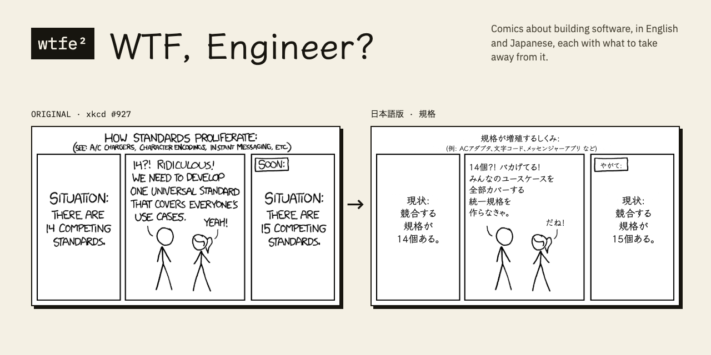
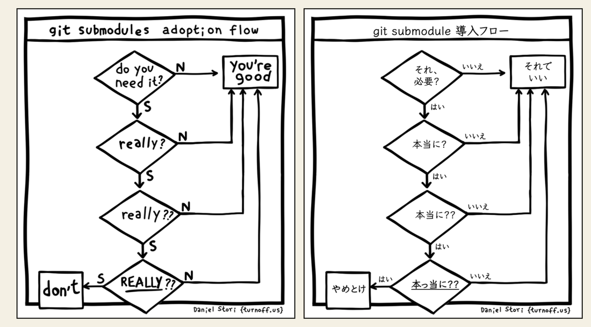
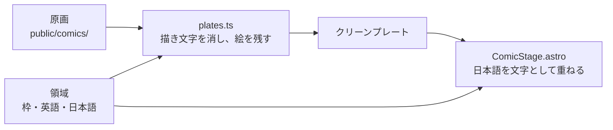
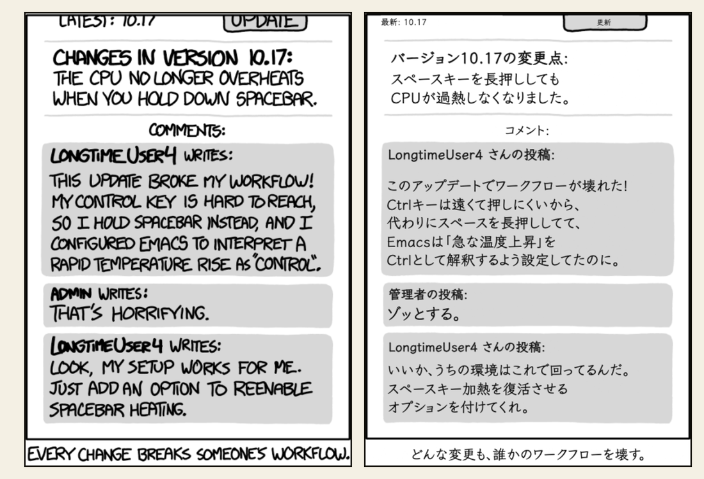

**ソフトウェアを作るという奇妙な仕事を描いた漫画を、英語と日本語で読むサイト。** ライセンスが改変か翻訳を認めている作品は、絵の中の描き文字を日本語に差し替える。それ以外の作品は、自分たちの言葉で筋書きを書いて解説する。どのページも、先頭に「ここから学べること」を置く。名前の ² は二か国語の意味。

[](https://0-draft.github.io/wtfe2/)
[](https://0-draft.github.io/wtfe2/ja/)
[](https://0-draft.github.io/wtfe2/ja/#translated)
[](https://0-draft.github.io/wtfe2/ja/#explained)
[](https://github.com/0-draft/wtfe2/actions/workflows/ci.yml)
[](./LICENSE)

[English](./README.md) • **日本語**

---

## なにをするサイトか

「プログラマー向けの面白い漫画」のまとめはたいていリンクを並べただけで、英語を読まない人には良い作品が届かない。wtfe² は、改変が許されている作品を翻訳漫画と同じやり方で日本語にする。絵から英語の描き文字を消し、そこに日本語を入れる。



*「git submodules adoption flow」Daniel Stori 作、[turnoff.us](https://turnoff.us/geek/git-submodules/)、CC BY-NC-SA 4.0。右は wtfe2 による日本語の翻案で、ライセンスは原作と同じ。*

各作品のページに載せているもの:

- 作品そのもの。英語版のページでは原画、日本語版のページでは日本語の描き文字で、スイッチで見比べられる
- 先頭に「ここから学べること」。明日から何を変えるか
- どこが刺さるかの短い解説。作品が実はエンジニアリングの法則を描いている場合は [Hammurabi](https://kanywst.github.io/hammurabi/ja/) へのリンク
- 英日両方の書き起こしと、xkcd のホバーテキストの翻訳
- ライセンスが求めるクレジット (原作、作者、画像の出典、ライセンス)

## サイト

| サイト | 作者 | ライセンス | このサイトでの扱い |
| --- | --- | --- | --- |
| [xkcd](https://xkcd.com/) | Randall Munroe | CC BY-NC 2.5 | 日本語版あり |
| [TurnOff.us](https://turnoff.us/) | Daniel Stori | CC BY-NC-SA 4.0 | 日本語版あり |
| [Browserling Comics](https://comic.browserling.com/) | Browserling | CC BY-NC 4.0 | 日本語版あり |
| [Bonkers World](https://bonkersworld.net/) | Manu Cornet | CC BY-NC-ND 3.0 (作者が翻訳を許可) | 日本語版あり |
| [Abstruse Goose](https://github.com/s-macke/Abstruse-Goose-Archive) | 匿名 | CC BY-NC 3.0 US | 日本語版あり |
| [SMBC](https://www.smbc-comics.com/) | Zach Weinersmith | 記載なし | 解説あり |
| [Existential Comics](https://existentialcomics.com/) | Corey Mohler | 記載なし | 解説あり |
| [MonkeyUser](https://www.monkeyuser.com/) | 記載なし | 全権利留保 | 解説あり |
| [The Daily WTF](https://thedailywtf.com/) | Alex Papadimoulis、Remy Porter | 著作権は Inedo | 解説あり |
| [CommitStrip](https://www.commitstrip.com/en/) | Etienne Issartial、Thomas Gx | 非商用ならクレジット付きで利用可 | 解説あり |
| [The Oatmeal](https://theoatmeal.com/) | Matthew Inman | 著作権あり | 解説あり |
| [PHD Comics](https://phdcomics.com/) | Jorge Cham | 転載は許可制 | 解説あり |

翻案している作品はどれも非商用に限って利用が許されているので、広告もスポンサーもアフィリエイトリンクも置かない。

## 描き文字の作り方



1. `src/data/comics/<slug>.json` に、作品の描き文字を領域ごとに記録する。画像内の枠、原文そのまま、手で改行を入れた日本語の 3 つ。
2. `scripts/plates.ts` が原画のコピーから描き文字を消す。枠に完全に収まるインクの線は描き文字として消し、枠からはみ出す線 (吹き出しの輪郭、しっぽ、フローチャートの菱形など) は絵として残す。薄いアンチエイリアスも消すが、残した線のすぐ隣には手を付けない。
3. `src/components/ComicStage.astro` が、プレートの上に日本語を文字として重ねる。位置は割合、大きさはコンテナクエリ単位で指定しているので、画像と一緒に拡大縮小してもくっきりしたままで、検索も選択もでき、スクリーンリーダーでも読める。



*「Workflow」Randall Munroe 作、[xkcd.com/1172](https://xkcd.com/1172/)、CC BY-NC 2.5。右は wtfe2 による日本語の翻案で、ライセンスは原作と同じ。*

## 作品の追加

1. そのサイトのライセンスが改変を認めているか確認する。対象は `src/data/sites.json` で `"tier": "translated"` のサイトだけ。
2. 原画を `public/comics/<slug>.png` に保存する。配信元に 2x の画像があればそちらを使う。
3. 描き文字をおおまかに枠で囲み、`pnpm measure public/comics/<slug>.png x,y,w,h ...` でインクにぴったり合わせる。
4. `src/data/comics/<slug>.json` を書き、`pnpm plates <slug>` を実行して `public/plates/<slug>.png` を目で確認する。
5. チェックを走らせる。日本語がデスクトップかモバイルで枠からはみ出すと E2E テストが落ちる。

## 開発

Node 24 以上と pnpm が必要。

```sh
pnpm install
pnpm dev            # http://localhost:4321/wtfe2/
pnpm build          # プレート、サムネイル、dist/ に静的サイト
pnpm validate:data  # スキーマ、画像サイズ、領域の範囲、ライセンスの規則
pnpm test           # ユニットテスト (Vitest)
pnpm test:e2e       # ビルド済みサイトに Playwright + axe、デスクトップとモバイル
pnpm lint && pnpm lint:md && pnpm check
```

push と pull request のたびに、Biome、markdownlint、`astro check`、Vitest、データ整合性チェック、ビルド、Playwright + axe、内部リンクチェック、actionlint、zizmor、依存関係の監査を走らせ、通れば `main` を GitHub Pages にデプロイする。CodeQL と外部リンクの全件チェックは毎週走る。pull request には誤訳、ライセンスの扱いの誤り、事実の誤りを見る Claude のレビューが付き、Dependabot が npm パッケージと Actions を最新に保つ。

## ライセンス

- コード: [MIT](LICENSE)。
- このサイトのために書いた文章 (解説、紹介文、画面の文言): [CC BY-NC-SA 4.0](https://creativecommons.org/licenses/by-nc-sa/4.0/deed.ja)。漫画の翻訳は、その作品のライセンスに従う。
- 漫画の権利は各作者にある。各ページに原作、作者、ライセンスを記載し、翻案した画像は原作と同じライセンスで公開する。

ここに載っている漫画の作者で、変更や削除を希望する場合は [issue を立ててほしい](https://github.com/0-draft/wtfe2/issues)。作者からの依頼を最優先で扱う。
