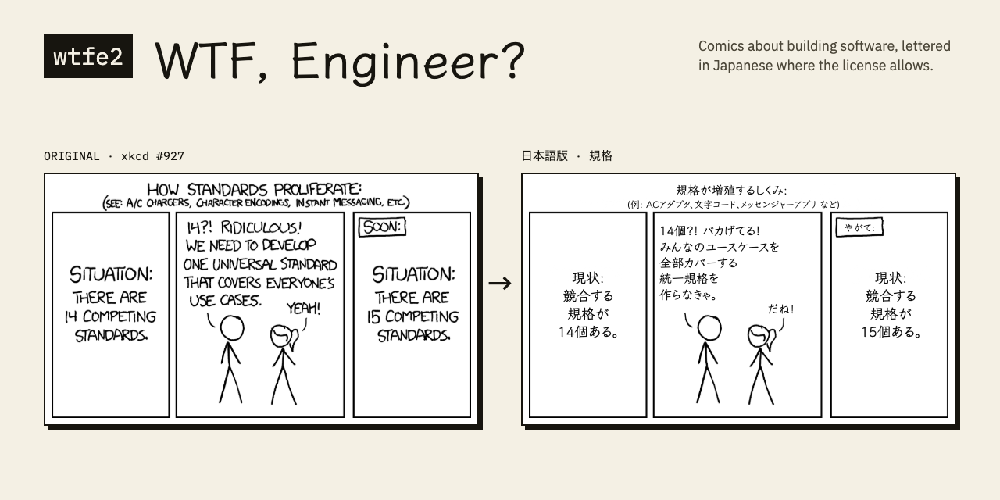
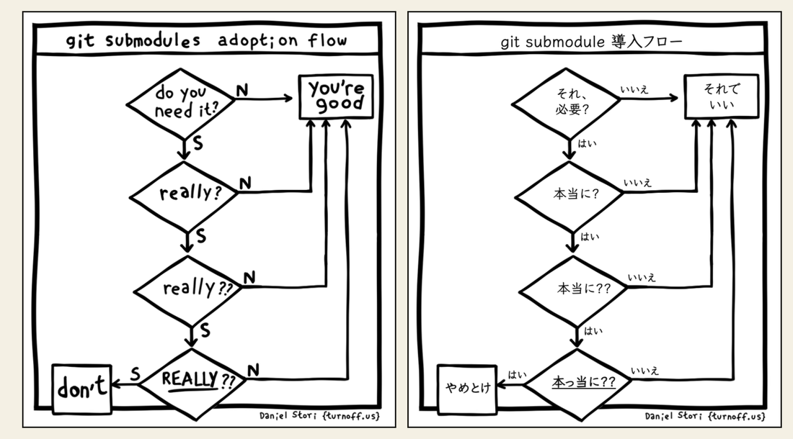
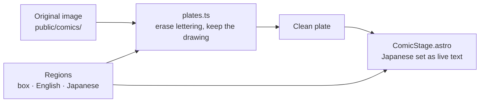
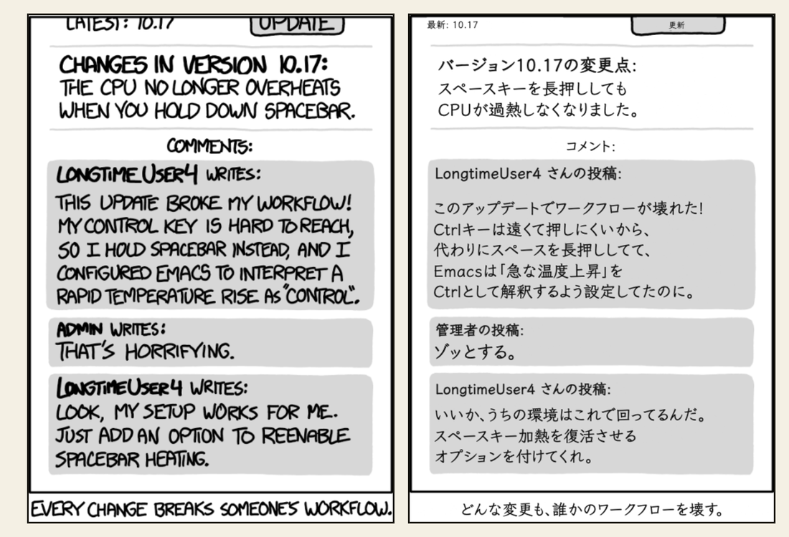

**Comics about the strange job of building software, read in English and Japanese.** Strips whose license allows adaptation or translation get Japanese lettering drawn into the art; the rest are retold in our own words. Every page leads with what to take away from it. The ² is for the two languages.

[](https://0-draft.github.io/wtfe2/)
[](https://0-draft.github.io/wtfe2/ja/)
[](https://0-draft.github.io/wtfe2/#translated)
[](https://0-draft.github.io/wtfe2/#explained)
[](https://github.com/0-draft/wtfe2/actions/workflows/ci.yml)
[](./LICENSE)

**English** • [日本語](./README.ja.md)

---

## What it does

Most "funny programming comics" lists are a wall of links, and the good strips stay out of reach for anyone who does not read English. wtfe² takes the strips that are licensed for it and letters them in Japanese, the way a translated manga would be: the English lettering is removed from the art and Japanese is set in its place.



*“git submodules adoption flow” by Daniel Stori, [turnoff.us](https://turnoff.us/geek/git-submodules/), CC BY-NC-SA 4.0. Right: Japanese adaptation by wtfe2, same license.*

Every comic page has:

- the strip, in the original on the English page and lettered in Japanese on the Japanese page, with a switch to compare;
- a takeaway at the top: what to do differently on Monday;
- a short note on why it lands, and links into [Hammurabi](https://kanywst.github.io/hammurabi/) when a strip is an engineering law in disguise;
- a full transcript in both languages, and xkcd's hover text translated;
- the credit line the license asks for: original, author, image source and license.

## The sites

| Site | Creator | License | Here |
| --- | --- | --- | --- |
| [xkcd](https://xkcd.com/) | Randall Munroe | CC BY-NC 2.5 | Lettered in Japanese |
| [TurnOff.us](https://turnoff.us/) | Daniel Stori | CC BY-NC-SA 4.0 | Lettered in Japanese |
| [Browserling Comics](https://comic.browserling.com/) | Browserling | CC BY-NC 4.0 | Lettered in Japanese |
| [Bonkers World](https://bonkersworld.net/) | Manu Cornet | CC BY-NC-ND 3.0, translations allowed by the author | Lettered in Japanese |
| [Abstruse Goose](https://github.com/s-macke/Abstruse-Goose-Archive) | anonymous | CC BY-NC 3.0 US | Lettered in Japanese |
| [SMBC](https://www.smbc-comics.com/) | Zach Weinersmith | © Zach Weinersmith | Lettered in Japanese |
| [Existential Comics](https://existentialcomics.com/) | Corey Mohler | none published | Explained |
| [MonkeyUser](https://www.monkeyuser.com/) | uncredited | all rights reserved | Explained |
| [The Daily WTF](https://thedailywtf.com/) | Alex Papadimoulis, Remy Porter | copyright Inedo | Explained |
| [CommitStrip](https://www.commitstrip.com/en/) | Etienne Issartial, Thomas Gx | non-commercial use with credit | Explained |
| [The Oatmeal](https://theoatmeal.com/) | Matthew Inman | copyright | Explained |
| [PHD Comics](https://phdcomics.com/) | Jorge Cham | © Jorge Cham | Lettered in Japanese |

The site carries no ads, sponsorships or affiliate links: every comic it adapts is licensed for non-commercial use only.

## How the lettering is made



1. Each strip in `src/data/comics/<slug>.json` lists its lettering as regions: the box in the image, the original text verbatim, and the Japanese broken into lines by hand.
2. `scripts/plates.ts` erases the lettering from a copy of the art. An ink stroke that lies wholly inside a box is lettering and goes; a stroke that leaves it (a balloon outline, a speech tail, a flowchart diamond) is drawing and stays. Faint anti-aliasing is cleaned up everywhere except right next to a kept stroke.
3. `src/components/ComicStage.astro` sets the Japanese over the plate as real text, positioned in percentages and sized in container-query units, so it scales with the image, stays sharp, and can be searched, selected and read by screen readers.



*“Workflow” by Randall Munroe, [xkcd.com/1172](https://xkcd.com/1172/), CC BY-NC 2.5. Right: Japanese adaptation by wtfe2, same license.*

## Adding a strip

1. Check the site's license allows adaptation. Only sites marked `"tier": "translated"` in `src/data/sites.json` qualify.
2. Save the original as `public/comics/<slug>.png`, the 2x file when the publisher has one.
3. Draw rough boxes around the lettering and tighten them to the ink with `pnpm measure public/comics/<slug>.png x,y,w,h ...`.
4. Write `src/data/comics/<slug>.json`, run `pnpm plates <slug>`, and look at `public/plates/<slug>.png`.
5. Run the checks. The end-to-end suite fails if any Japanese leaves its box on desktop or mobile.

## Development

Requires Node 24+ and pnpm.

```sh
pnpm install
pnpm dev            # http://localhost:4321/wtfe2/
pnpm build          # plates, thumbnails, then the static site in dist/
pnpm validate:data  # schema, image sizes, region bounds, license rules
pnpm test           # unit tests (Vitest)
pnpm test:e2e       # Playwright + axe on the built site, desktop and mobile
pnpm lint && pnpm lint:md && pnpm check
```

Every push and pull request runs Biome, markdownlint, `astro check`, Vitest, the data-integrity check, the build, Playwright with axe, an internal link check, actionlint, zizmor and a dependency audit; `main` deploys to GitHub Pages once they pass. CodeQL and a check of every outbound link run weekly. Pull requests also get a Claude review for mistranslations, licensing slips and factual errors, and Dependabot keeps npm packages and Actions current.

## License

- Code: [MIT](LICENSE).
- Text written for this site (notes, descriptions, interface): [CC BY-NC-SA 4.0](https://creativecommons.org/licenses/by-nc-sa/4.0/). Translations of a comic follow that comic's license.
- Comics belong to their creators. Each page names the original, its author and its license, and adapted images are shared under the original's license.

If you made one of these comics and want something changed or removed, [open an issue](https://github.com/0-draft/wtfe2/issues). Requests from creators come first.
